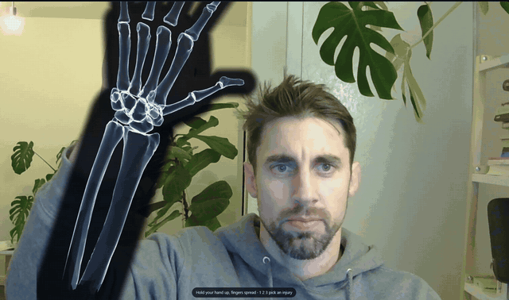
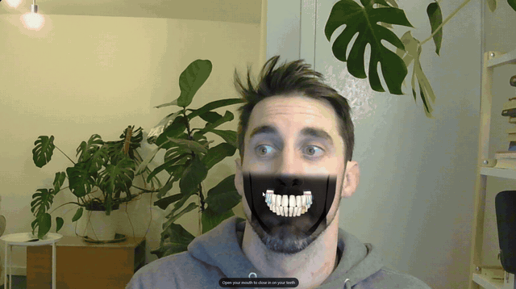
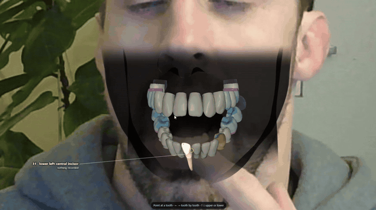
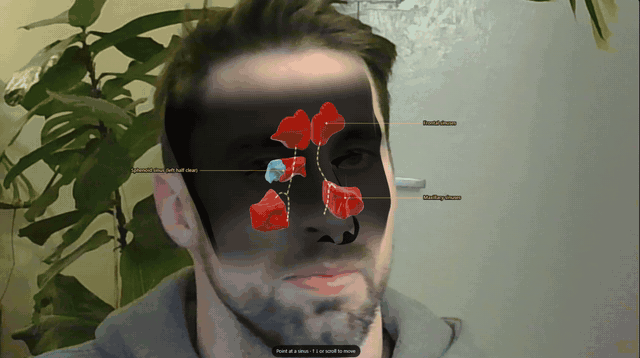
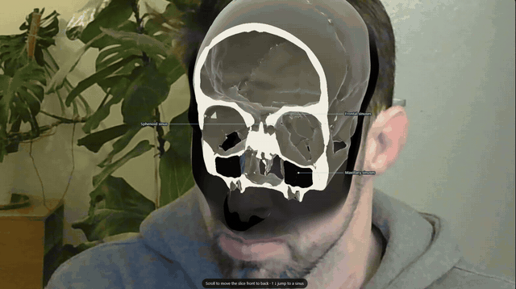
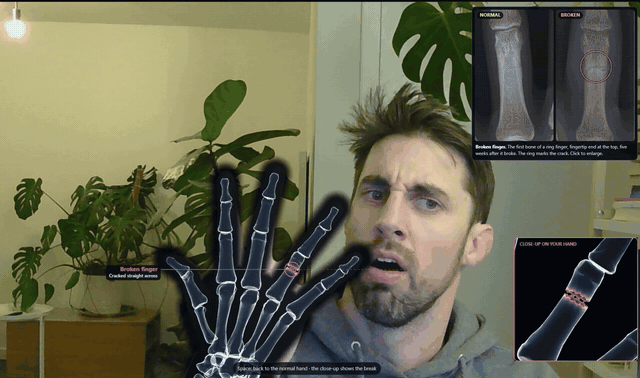
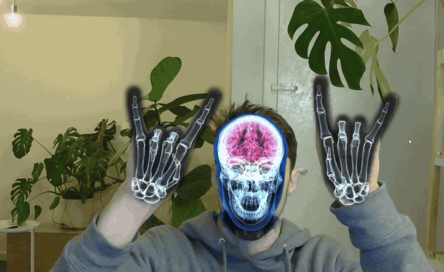
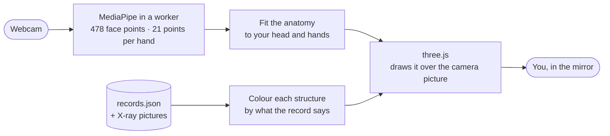

<h1 align="center">Health X-ray Mirror</h1>

<p align="center">
  <b>A webcam mirror that draws medical records on your own body.</b><br>
  Hold up a hand and see its bones. Open your mouth and point at a tooth. Turn your head and look into your sinuses.
</p>

<p align="center">
  Inspired by and built on <a href="https://github.com/MasterOfVFX2070/xray-mirror"><b>X-Ray Mirror</b> by MasterOfVFX2070</a>.
  The webcam X-ray idea, the tracking and the X-ray look come from that project:
  <a href="https://www.reddit.com/r/ClaudeAI/comments/1xstews/i_built_a_webcam_xray_mirror_with_claude_fable_52/"><b>see the original Reddit post</b></a>.
</p>

<p align="center">
  <a href="https://teamgonuts.github.io/health-xray-mirror/poc/"><b>▶ Try it in your browser</b></a>
  &nbsp;·&nbsp;
  <a href="https://teamgonuts.github.io/health-xray-mirror/poc/?demo">Watch it without a camera</a>
  &nbsp;·&nbsp;
  <a href="#run-it-yourself">Run it yourself</a>
</p>

<p align="center">
  <a href="https://teamgonuts.github.io/health-xray-mirror/poc/hand.html"></a>
</p>

It runs entirely in the browser. **The camera picture never leaves your computer**, there is nothing to install,
and everything it shows is sample data until you add records of your own.

> Chrome or Edge on a laptop or desktop works best. Click **Start camera**, allow the camera, and step back a
> little so your face and hands fit in the picture.

## Four views

Click a picture to open that view live.

<table>
<tr>
<td width="50%" valign="top">

### 🦷 Teeth

<a href="https://teamgonuts.github.io/health-xray-mirror/poc/?mode=teeth"></a>

**Open your mouth** and the picture closes in on your teeth. Teeth with a filling, a chip or a sensitive neck
are coloured from the dental record.

</td>
<td width="50%" valign="top">

### 👉 Point at a tooth

<a href="https://teamgonuts.github.io/health-xray-mirror/poc/?mode=teeth"></a>

**Point with a finger** and that tooth lights up with its root, its history and the X-ray it appears on.

</td>
</tr>
<tr>
<td valign="top">

### 👃 Sinuses, then and now

<a href="https://teamgonuts.github.io/health-xray-mirror/poc/?mode=sinus"></a>

Two dates from one record, side by side on your face: **inflamed** in red, **clear** in blue, with the
drainage channels flowing when they are open.

</td>
<td valign="top">

### 🧠 Slice through the skull

<a href="https://teamgonuts.github.io/health-xray-mirror/poc/?mode=sinus&look=slice"></a>

The **Slice** look cuts through your head the way a CT scan does. Scroll to move the cut from front to back.

</td>
</tr>
<tr>
<td valign="top">

### ✋ Hand X-ray

<a href="https://teamgonuts.github.io/health-xray-mirror/poc/hand.html"></a>

27 real bones follow your hand. Pick an example injury and the bone breaks where the **real X-ray** beside it
shows the break, with a close-up in the corner.

</td>
<td valign="top">

### 💀 The original X-Ray Mirror

<a href="https://teamgonuts.github.io/health-xray-mirror/poc/original.html"></a>

Skull, brain, muscles and hand bones, by [MasterOfVFX2070](https://github.com/MasterOfVFX2070/xray-mirror)
([Reddit post](https://www.reddit.com/r/ClaudeAI/comments/1xstews/i_built_a_webcam_xray_mirror_with_claude_fable_52/)). Everything else here is inspired by it and built on top of it.

</td>
</tr>
</table>

## Try these

| Do this | What happens |
| --- | --- |
| Open your mouth in the **Teeth** view | The picture zooms in on your teeth and backs out when you close it |
| Point a finger at a tooth or a sinus | It is selected and its record opens in the side panel |
| Press <kbd>←</kbd> <kbd>→</kbd> in the Teeth view | Walk along the teeth one by one (<kbd>↑</kbd> <kbd>↓</kbd> switch between upper and lower) |
| Click the two dates in the **Sinuses** view | Compare the earlier record with the later one |
| Choose **Slice** under Look | A CT-style cut through your head; scroll to move it |
| Press <kbd>1</kbd> <kbd>2</kbd> <kbd>3</kbd> in the **Hand X-ray** view | Broken wrist, broken knuckle, broken finger. <kbd>0</kbd> is the normal hand, <kbd>Space</kbd> flips between the two |
| Click the X-ray card | Enlarge the broken and the normal X-ray side by side |

No webcam? These open a built-in test scene instead:
[sinuses](https://teamgonuts.github.io/health-xray-mirror/poc/?demo) ·
[teeth](https://teamgonuts.github.io/health-xray-mirror/poc/?demo&mode=teeth&jaw=0.6&tooth=46) ·
[broken wrist](https://teamgonuts.github.io/health-xray-mirror/poc/hand.html?demo&pick=wrist) ·
[original](https://teamgonuts.github.io/health-xray-mirror/poc/original.html#demo)

## How it works



- **Tracking** is [MediaPipe Tasks Vision](https://ai.google.dev/edge/mediapipe/solutions/guide): the Face
  Landmarker (with the jaw-open signal that drives the teeth zoom) and the Hand Landmarker. It runs in a
  worker so the page stays smooth.
- **Anatomy** is real: teeth, skull, jaw, nasal bones and the 27 hand bones come from the open
  [BodyParts3D](https://github.com/Kevin-Mattheus-Moerman/BodyParts3D) dataset, fitted to your face and hand.
  The sinus cavities are reconstructed inside the real skull bones, because the dataset models bone as solid.
- **Records** are plain JSON. Each tooth and each sinus has a state per date; the page turns that into colour.
- **Drawing** is [three.js](https://threejs.org/) with custom shaders. The camera frame and the anatomy are
  drawn in the same pass, so the overlay cannot drift off your face.

Nothing here is a scan of *you*. It is one adult's anatomy scaled to your head, coloured by a record.

## The sample data

Everything you see is made up, and the page shows a **Sample data** badge to say so:

- **Sinuses and teeth:** a fictional person in [`poc/data.example/records.json`](poc/data.example/records.json).
- **Dental X-rays:** one full-mouth series a dentist published of his own mouth (Dr Jeffrey Cross DDS,
  Wikimedia Commons, CC BY-SA 3.0). Which tooth each picture is tied to is for illustration only.
- **Hand X-rays:** openly licensed X-rays of other people's injuries from Wikimedia Commons. Credits are on the
  page and in [`poc/assets/hand-xrays/credits.json`](poc/assets/hand-xrays/credits.json).

<details>
<summary><b>Use your own records</b></summary>

<br>

Copy `poc/data.example/` to `poc/data/` and edit `records.json`. The page looks in `poc/data/` first and falls
back to the sample. `poc/data/` is in `.gitignore`, so your records stay on your computer.

```jsonc
{
  "sinuses": {
    "periods": { "child": { "label": "2010", "drainage": "unknown" }, "2020": { "label": "2024", "drainage": "open" } },
    "structures": {
      // state: clear | inflamed | surgery | removed | normal | none, and per side where a record says so
      "ethmoid": { "child": { "state": "inflamed", "sides": { "R": "clear" }, "text": "…" }, "2020": { "state": "clear", "text": "…" } }
    }
  },
  "teeth": {
    // teeth use FDI numbers: 11–18 upper right, 21–28 upper left, 31–38 lower left, 41–48 lower right
    "events": { "46": [{ "date": "2021-11", "type": "filling", "surfaces": 3, "text": "Three-surface filling" }] },
    "xrays": [{ "file": "xrays/lower-right-molars.jpg", "date": "2019-03-12", "kind": "Periapical", "teeth": ["46", "47"], "note": "…" }]
  }
}
```

Event types are `filling`, `extracted`, `chipped`, `sensitive`, `planned` and `xray`.

</details>

<details>
<summary><b>Add your own example injury to the Hand X-ray view</b></summary>

<br>

An injury is one entry in [`poc/hand-cases.json`](poc/hand-cases.json) plus an X-ray picture. The entry names
the bone, how far along it the break is, the angle of the break, how the loose piece is tilted and shifted,
and where the ring sits on the X-ray. The file documents every field.

</details>

## Run it yourself

```bash
git clone https://github.com/teamgonuts/health-xray-mirror.git
cd health-xray-mirror
npm start
```

Then open <http://localhost:8765/poc/> in Chrome or Edge.

There is no install step: `serve.mjs` is a small Node server with no dependencies, and any other static server
works too (`python -m http.server 8765`). The page must come from `localhost` or HTTPS, because browsers only
give the webcam to secure pages. The first start downloads three.js, the MediaPipe runtime and two tracking
models (about 23 MB) from jsDelivr and Google's model storage.

<details>
<summary><b>What is in the repository</b></summary>

<br>

| Path | What it is |
| --- | --- |
| `index.html`, `X-Ray Mirror.html` | The original X-Ray Mirror, unchanged |
| `poc/index.html`, `poc/app.js` | The Sinuses and Teeth views |
| `poc/hand.html`, `poc/hand.js` | The Hand X-ray view |
| `poc/original.html` | The original app in a frame, with the four tabs added |
| `poc/sinuses.js`, `poc/teeth.js`, `poc/head.js`, `poc/gfx.js` | Anatomy and shaders |
| `poc/tracker.js`, `poc/tracker-worker.js` | Face and hand tracking in a worker |
| `poc/assets/` | Built anatomy (`head.*`, `hand.*`) and the example hand X-rays |
| `poc/data.example/` | The sample records and sample dental X-rays |
| `tools/` | Scripts that build the anatomy from BodyParts3D, and a test browser |

</details>

<details>
<summary><b>Test and debug links</b></summary>

<br>

| URL | What it does |
| --- | --- |
| `poc/?demo` | A pretend head turning slowly, no camera. Add `&still&yaw=0.3&jaw=0.5` to freeze a pose |
| `poc/?mode=sinus&focus=maxillary&period=child&look=slice` | Open a given sinus view |
| `poc/?mode=teeth&tooth=36&tlook=xray` | Open a given tooth |
| `poc/hand.html?demo&pick=wrist` | The dataset's own hand, with an injury (`wrist`, `knuckle`, `finger`, `none`) |
| `poc/?video=<url>` | Use a video clip instead of the webcam |
| `poc/?perf` | Show tracking and drawing speed |
| `poc/?point=0` | Finger pointing off |
| `poc/inspect.html` | Plain views of the built anatomy on a 1 cm grid |

</details>

## Credits and licences

- **X-Ray Mirror** (`index.html`) is by [MasterOfVFX2070](https://github.com/MasterOfVFX2070/xray-mirror), first shown in
  [this Reddit post](https://www.reddit.com/r/ClaudeAI/comments/1xstews/i_built_a_webcam_xray_mirror_with_claude_fable_52/).
  This repository is a fork of it: the idea of an X-ray mirror on a webcam, the MediaPipe and three.js approach and the
  X-ray look all come from that project, and every page of the demo says so at the bottom. The original has no licence
  file, so its code remains its author's.
- **Anatomy models:** BodyParts3D, © The Database Center for Life Science, licensed under
  [CC BY-SA 2.1 Japan](https://creativecommons.org/licenses/by-sa/2.1/jp/deed.en).
- **Hand X-rays:** Mikael Häggström, M.D. (CC0), Hellerhoff (CC BY-SA 3.0 and 4.0) and Roberto J. Galindo
  (CC BY-SA 4.0), all from Wikimedia Commons.
- **Sample dental X-rays:** Dr Jeffrey Cross DDS, Wikimedia Commons, CC BY-SA 3.0.

This is a demo, not a medical tool. It does not diagnose anything.
